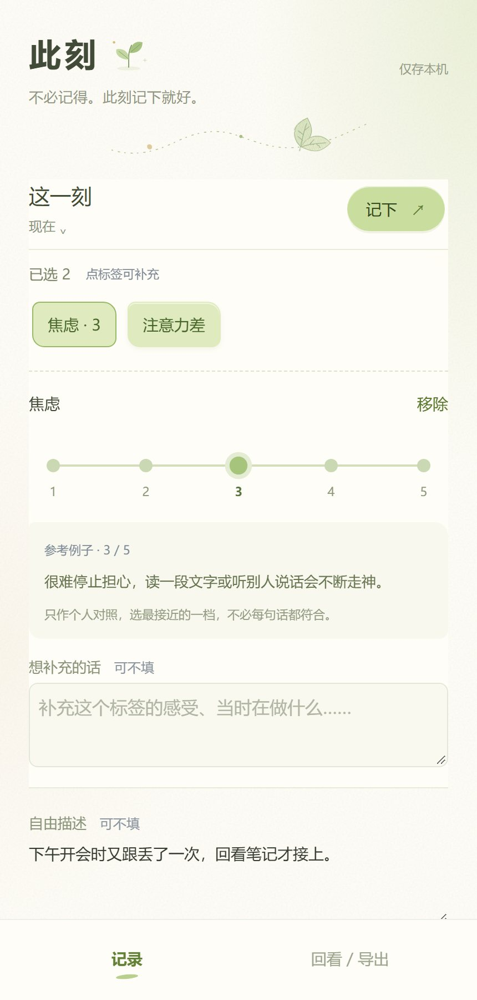

# 此刻

> 不必记得。此刻记下就好。



一个只存在自己手机里的记录工具。它要解决的问题很具体：

**去医院时，说不清自己最近怎么了。**

「最近怎么样？」——多数人只能回答「还行」或者「不太好」，然后漏掉真正影响生活的细节：什么时候开始的、持续多久、在什么情况下加重。这个 App 把那些说不清的东西，变成一份能带进诊室、能翻给医生看的记录。

## 怎么用

1. 挑几个词。情绪、身体、状态、念头与冲动、活动、用药，不够用可以自己加标签，加的时候选好归到哪一类。
2. 需要的标签选 1–5 程度；身体类可以标部位。
3. 每个标签能补充，整条记录也能写一段自由描述。也可以什么都不写，只留一个词。
4. 需要时按 7 / 14 / 30 天或自选日期回看，导出一份 Word。

「手边的词」是常用栏，点一下加入、再点一下移出；分类列表底部可以添加新标签。

## 几条刻意的克制

| 做法 | 原因 |
|---|---|
| 未评分不代表零程度 | 没打分是「没打」，不是「没有」 |
| 未记录不代表未发生 | 记录稀疏不等于状态变好 |
| 不跨标签加总、不出总分 | 「疲惫 3」和「焦虑 3」不是同一种东西，加起来没有意义 |
| 5 档只作个人对照 | 和上周的自己比，不和别人比 |
| 不诊断、不评价、不给建议 | 判断留给医生，工具只负责把事实留住 |

## 隐私

- 记录只写入本机 WebView 的 `localStorage`：没有账号，没有服务器，没有网络请求。
- Android 清单不申请网络权限、不申请存储权限，系统云备份已关闭。
- 导出 Word 走系统文件保存器，存到哪里由你决定，App 不访问其他文件。

代价也要说清楚：**卸载应用或清除应用数据，记录会一起消失。** 目前没有实现导入恢复，Word 文件用于阅读和编辑。

## 目录结构

```
demo/
  dist/            前端页面：index.html / style.css / app.js，也是 APK 的资源来源
android/           WebView 壳工程、Word 生成器、不依赖 Gradle 的构建脚本
outputs/           构建产物（APK）与示例导出
```

界面是一个纯静态页面，Android 端只是一个 WebView 壳：资源由 `shouldInterceptRequest` 从 assets 提供，导出 Word 时通过 JavaScript 接口把数据交给 Java，由 `ReportDocx` 直接生成 OOXML。

## 构建

工具链（JDK 21、SDK Platform 35、Build Tools 35）放在 `.build-tools/`，不进版本库，也不修改全局配置。

```powershell
powershell -NoProfile -ExecutionPolicy Bypass -File android/build-apk.ps1
```

脚本直接调用 aapt2、javac、D8、zipalign、apksigner，不需要 Gradle 下载。细节与已知问题见 [android/README.md](android/README.md)。

## 版本

| 版本 | 内容 |
|---|---|
| 0.1.4 | 「手边的词」只管理常用词；分类底部「其他 / 不确定」改为「＋ 添加新标签」，新建时自选分类 |
| 0.1.3 | 自定义标签可评分并计入导出均分；新增记录级自由描述；自定义标签可删除 |
| 0.1.2 | 历史记录编辑、删除与撤销删除，支持跨重启恢复 |
| 0.1.1 | 记录操作栏固定，标签单独补充，念头与冲动支持强烈程度 |
| 0.1.0 | 首次提交：苔绿纸感界面，标签记录 + 五档程度参考 |

## 说明

个人工具，非医疗器械，不提供任何医疗建议，也不能替代诊断。代码按现状提供。
